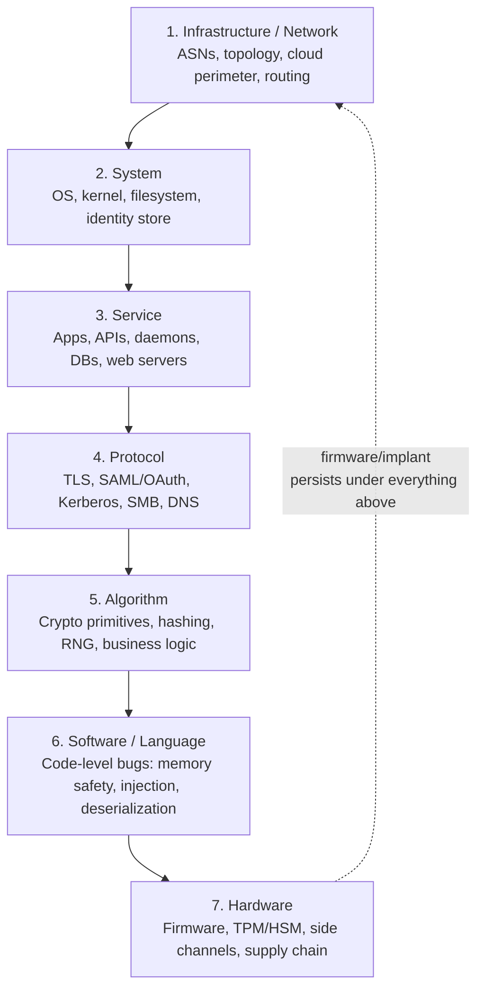

# 7-Strata Attack & Defense Guide

### Infrastructure/Network → System → Service → Protocol → Algorithm → Software/Language → Hardware

This stratifies offense and defense by *where in the stack* a technique operates, rather than by kill-chain phase (recon/exploit/persist/etc., which cuts across every layer). For each stratum: **Scan** (how it's enumerated), **Attack** (categories of technique, at methodology level — not weaponized payloads), and **Defend** (Detect / React / Recover).

---

## 1. Infrastructure / Network Layer

**Scope:** ASN/IP space, cloud account perimeter, VPC/subnet design, routing, VPN/remote-access gateways, CDN/edge.

**Scan**

- Passive: WHOIS, ASN lookups, certificate-transparency logs, DNS history, cloud-storage bucket guessing, shodan/censys-style exposure search.
- Active: port/service sweeps, cloud IAM permission probing (dry-run API calls that test what a credential *could* do without executing it), ARM/CFN deployment-validation dry-runs, network topology mapping via traceroute/BGP looking glass.

**Attack (categories)**

- Exploiting internet-exposed management planes (Kudu/SCM, hypervisor consoles, backup platforms) left reachable from the public internet.
- Cross-account/cross-tenant trust abuse — walking a federation or B2B trust relationship from a weaker party into a stronger one.
- VPN/remote-access compromise via leaked configs or credential stuffing.
- DNS hijacking / subdomain takeover on orphaned CNAME records.

**Defend**

- *Detect:* egress/ingress anomaly baselining; alert on sub-second IAM capability probing, ARM dry-run bursts, unexpected admin-plane access from non-corporate ASNs.
- *React:* network-segment isolation of the exposed path; revoke/rotate the credential or trust relationship used; block at edge/WAF while investigating.
- *Recover:* re-architect so admin/publishing interfaces sit behind private connectivity or Zero Trust access only; require architecture review before any new public IP allocation.

---

## 2. System Layer

**Scope:** OS (Windows/Linux), kernel, filesystem permissions, local identity (SAM/AD/LAPS), process execution.

**Scan**

- OS/version fingerprinting, patch-level enumeration, local privilege enumeration (`whoami /priv`, SUID/SGID sweeps), EDR/sensor-coverage mapping (which hosts lack an agent).
- AD enumeration: object counts, group memberships, GPO contents, LAPS password readability.

**Attack (categories)**

- Local privilege escalation via misconfigured permissions, unpatched kernel CVEs, or service account abuse.
- Credential harvesting from password stores (LSASS, LAPS, GPP).
- Kerberos abuse: Kerberoasting (requesting service tickets to crack offline), DCSync (requesting domain replication to steal `krbtgt`), ticket forgery.
- Lateral movement primitives: Pass-the-Hash, Pass-the-Ticket, WinRM abuse.

**Defend**

- *Detect:* LAPS read alerts; abnormal Kerberos ticket-request volume (Kerberoasting signature); DCSync detection (replication requests from non-DC hosts); EDR-coverage gap monitoring as its own alert category (attackers enumerating *you* enumerating gaps is itself a signal).
- *React:* force krbtgt double-reset if DCSync suspected; isolate hosts lacking EDR immediately; disable compromised local/service accounts.
- *Recover:* tiered administration model (Tier 0/1/2) so a workstation compromise can't reach DC credentials; patch cadence SLA tied to CVSS + exploitability, not just severity.

---

## 3. Service Layer

**Scope:** Web apps, REST/GraphQL APIs, databases, mail servers, CI/CD, SaaS integrations, partner/employee portals.

**Scan**

- Directory/endpoint fuzzing, API schema discovery (OpenAPI/GraphQL introspection), authenticated vs. unauthenticated surface mapping, dependency/secret scanning of exposed repos.

**Attack (categories)**

- Exploiting public-facing apps: SQLi, IDOR, SSRF, SSTI, command injection, auth bypass, XXE.
- Supply-chain pivoting: compromising a third-party integration or CI/CD pipeline to reach the primary target.
- Business-logic abuse: sequential record enumeration against a portal with no rate limit; transaction/recipient-limit bypass.
- Web shell deployment (JSP/PHP) including via log-poisoning.

**Defend**

- *Detect:* server-side authorization checks logged and alerted on anomaly; rate limiting with alerting on sequential/bulk lookups; file-integrity monitoring for unexpected web-app-path files (web shells).
- *React:* kill the session/API key, roll back the deployment, quarantine the affected service from the rest of the environment.
- *Recover:* input validation + parameterized queries by default (SAST/DAST gates in CI); continuous secret-scanning in repos/images/pipelines with auto-rotation on detection; least-privilege app-to-app OAuth scopes.

---

## 4. Protocol Layer

**Scope:** TLS, SAML/OAuth/OIDC, Kerberos, SMB, LDAP, DNS, SSH.

**Scan**

- TLS/cipher enumeration, SAML/OAuth metadata and token-signing-key discovery, SMB signing-requirement checks, open-resolver DNS checks.

**Attack (categories)**

- Forging unsigned/weakly-validated SAML assertions or OAuth tokens.
- SMB relay / LLMNR-NBT-NS poisoning to capture and relay authentication.
- Protocol tunneling to hide C2 inside allowed traffic (e.g., tunneling over SSH/HTTPS via tools like Chisel/SoftEther).
- DNS-based exfiltration or C2.

**Defend**

- *Detect:* alert on unsigned/forged assertions reaching the IdP; SMB-signing enforcement with relay-attempt alerting; DNS query anomaly detection (volume, entropy, rare record types).
- *React:* force IdP key rotation, invalidate active sessions/tokens tenant-wide if forgery suspected; block the tunneling egress path.
- *Recover:* mandate SAML/OAuth signature validation + short token lifetimes; enforce SMB signing and disable legacy NTLM/LLMNR network-wide; protocol allow-listing at the egress proxy.

---

## 5. Algorithm Layer

**Scope:** Cryptographic primitives, hashing/KDFs, random-number generation, authorization/business-logic algorithms (not code bugs — the *logic* itself).

**Scan**

- Identify algorithm choices in use (hash type, key length, signature scheme) via handshake/response fingerprinting or documentation/config review.

**Attack (categories)**

- Exploiting weak/legacy crypto (e.g., predictable RNG, short keys, deprecated hash use in signatures).
- Logic-flaw abuse: race conditions in authorization checks, flawed state machines (e.g., a workflow that can be driven into an unintended state), privilege-check ordering bugs.
- Offline cracking of poorly-salted/hashed credential stores.

**Defend**

- *Detect:* crypto-agility inventory (know every algorithm/key-length in use) so weak choices surface in audits rather than incident response; monitor for abnormal timing patterns indicating race-condition exploitation attempts.
- *React:* emergency key rotation / re-hash credential stores with a stronger KDF; patch the logic flaw and replay transaction logs to find exploitation.
- *Recover:* mandate current NIST-approved primitives via policy; threat-model business logic (not just code) during design review, not just pentest.

---

## 6. Software / Language Layer

**Scope:** Application source code, memory safety, parsing/deserialization, build toolchain.

**Scan**

- SAST/DAST, fuzzing, dependency/SCA scanning, binary diffing against known CVEs.

**Attack (categories)**

- Memory-corruption bugs (buffer overflow, use-after-free) in unsafe languages.
- Injection classes: command injection, deserialization of untrusted data, template injection.
- Supply-chain code attacks: typosquatted packages, compromised build pipelines, malicious dependency updates.

**Defend**

- *Detect:* runtime application self-protection (RASP) or EDR hooks on deserialization/exec calls; SBOM-based alerting when a dependency's provenance changes.
- *React:* roll back to last known-good build; revoke signing keys if the build pipeline is suspected compromised.
- *Recover:* memory-safe language migration for new critical-path code; reproducible/signed builds; dependency pinning + SBOM enforcement in CI gates.

---

## 7. Hardware Layer

**Scope:** Firmware/BIOS/UEFI, TPM/HSM, device drivers, physical supply chain, side channels.

**Scan**

- Firmware version/hash verification against vendor baselines, TPM attestation checks, physical port/device inventory.

**Attack (categories)**

- Firmware implants that persist across OS reinstalls.
- Side-channel attacks against crypto hardware (timing, power analysis) — primarily a concern for HSM/TPM-protected secrets.
- Hardware supply-chain tampering (compromised components before they reach the org).

**Defend**

- *Detect:* measured boot / remote attestation comparing firmware hashes against known-good baselines; anomaly detection on TPM quote failures.
- *React:* isolate and physically re-provision (reflash from verified source, or replace hardware) — firmware-level compromise generally can't be remediated by OS-level cleanup alone.
- *Recover:* vendor firmware signing + attestation requirements in procurement; chain-of-custody controls for hardware supply chain; HSM/TPM use for root-of-trust secrets specifically because they resist layer-6-and-above compromise.

---

## Cross-Layer Notes

- **Depth matters more than any single layer.** The ARTEX pattern from the prior advisory is a good illustration: it chains Layer 1 (cloud perimeter) → Layer 3 (vulnerable service) → Layer 2 (AD) → Layer 4 (Kerberos/SAML) in one automated run. A defense that's strong at one layer but weak at another still fails end-to-end.
- **Detection budget should scale with how automatable the layer is.** Layers 1–3 are what autonomous/agentic attack tooling hits fastest (cheap, scriptable, high-volume); layers 5–7 require more specialized tooling and are comparatively rarer in commodity campaigns but far more damaging when they succeed (persistence that survives a full OS wipe).
- **Recovery ordering:** when multiple layers are compromised simultaneously, remediate top-down for containment (cut network access first) but validate bottom-up for trust (firmware → OS → service → network) before declaring recovery complete — a clean OS reinstall on compromised firmware is not a clean system.