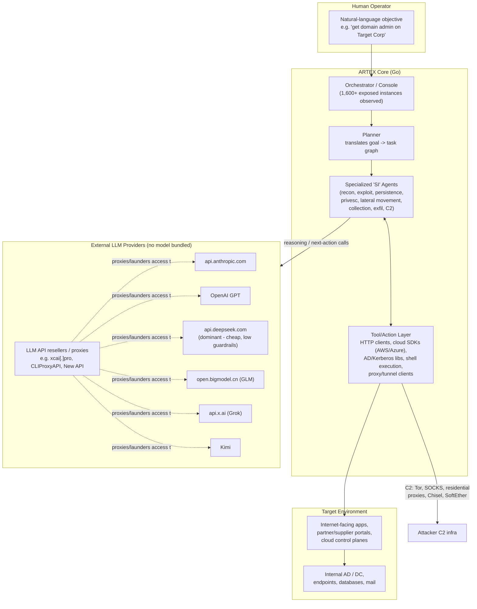

# ARTEX — Threat Overview & Defender's Guide

**Source:** FBI FLASH-20261113-001, "Threat Overview of ARTEX Autonomous Penetration Testing Framework" (13 Nov 2026), TLP:CLEAR. Everything here is drawn from, or directly attributed to, that advisory and its cited sources (Microsoft, CrowdStrike, Zscaler, Mandiant/GTIG, Censys, Akamai, Check Point, CERT-EU). This is a **detection and mitigation** reference for defenders, not a build or operator's guide — the advisory itself does not publish exploit code, prompts, or ARTEX's internals beyond the categories below, and neither does this document.

---

## 1. What ARTEX Is

- An **open-source, Go-written, multi-agent autonomous penetration-testing platform**, originally released on GitHub by developer "Autumn-27" in July 2026.
- Agents are described as "super intelligence (SI) agents" that translate a human's **natural-language tactical goal** ("get domain admin on target X") into a chain of machine-executed actions, with minimal human-in-the-loop interaction beyond setting the objective.
- **ARTEX ships no model of its own.** It's a control/orchestration layer that calls out to external LLM providers via API:
  - Frontier models: Anthropic Claude, OpenAI GPT
  - Open-source / China-origin models: DeepSeek, GLM (Zhipu), Grok, Kimi
  - Observed attacker traffic is dominated by **DeepSeek "Flash" family** models — attackers favor them for low cost and the absence of observable guardrails when prompts are framed as "penetration testing."
- The GitHub repo was taken down by the developer on **8 Oct 2026** after reports of criminal abuse, but the tool persists via forks, mirrors, archived copies, and a paid **ARTEX PRO** variant. As of early Nov 2026, researchers (Censys) found **1,600+ publicly exposed ARTEX console instances**, likely undercounting due to firewalled/private deployments.
- Timeline: reconnaissance → privileged access has been observed in **under 3 hours** in some intrusions.

### Why it's dangerous beyond "another scanner"

| Risk | Why it matters |
| --- | --- |
| **Scale** | One small group can run many concurrent campaigns against unrelated targets at once. |
| **Overlooked surfaces** | Agents are effective against partner/supplier portals, mobile backends, internal employee apps, sales-support tools, legacy services, and third-party integrations — the systems that get the least security review. |
| **Supply chain pivoting** | Agents map trust relationships between organizations and pivot from a weak vendor/CI-CD pipeline into the upstream enterprise. Observed: modification of iOS app distribution infra via exposed cloud creds; the ConnectWise Cloud Backup compromise reaching 2,250+ downstream tenants. |
| **Lower skill floor** | Non-experts can run sophisticated, chained intrusions. |
| **Noisy but fast** | Generates high volumes of forensically detectable traffic, but completes objectives faster than most defender response cycles. |

---

## 2. Architecture (as described in public reporting)

Key defensive implication: **every agent "thought" is an outbound API call to an LLM endpoint.** This is the single most distinctive network signature ARTEX leaves behind (see §5).

---

## 3. Attack Lifecycle — Phase by Phase

Each phase below is what has been **observed in the wild** per the FBI advisory, mapped to MITRE ATT&CK. This mirrors the advisory's own table because that table is itself defender-facing (detection mapping), not an operator manual.

### 3.1 Initial Reconnaissance

- Automated mapping of effective permissions on Azure credentials (SAS tokens, Service Principals, Kudu creds, Storage Account keys) via sub-second capability checks, test blob writes/deletes, and ARM deployment-validation dry-runs.
- Testing compromised AWS IAM permissions via `DryRun` flags.
- Web directory fuzzing (500+ requests in bursts).
- WHOIS asset mapping + active vulnerability scanning.
- Geolocation lookups against `api.db-ip[.]com` to profile victims.
- **ATT&CK:** T1595 Active Scanning · T1580 Cloud Infrastructure Discovery · T1087.004 Cloud Account Discovery · T1069.003 Cloud Groups Discovery · T1526 Cloud Service Discovery

### 3.2 Initial Access

- Unsigned SAML assertion abuse; XXE; anonymous file upload; SSRF; SQLi; IDOR; command injection RCE; SSTI RCE; auth bypass; weak admin credentials; hardcoded admin passwords found in SPA JS bundles; missing auth on web APIs; abuse of cross-account cloud trust from an external partner tenant; compromised third-party vendor creds used to pivot via trusted B2B federation; stolen VPN configs/leaked credentials.
- **ATT&CK:** T1190 Exploit Public-Facing App · T1078 Valid Accounts · T1133 External Remote Services · T1195 Supply Chain Compromise · T1199 Trusted Relationship · T1606.002 Forge SAML Tokens · T1552.001 Credentials in Files

### 3.3 Foothold / Persistence

- JSP/PHP web shells, including via MySQL log poisoning; abuse of Kudu admin APIs for arbitrary command execution; C2 implants on internal Windows DB servers; open-source RATs (**WISP, vshell, AdaptixC2**); new SSH keypairs + Elastic IP allocation; account takeover via password reset abuse; credentials added to existing OAuth apps.
- **ATT&CK:** T1505.003 Web Shell · T1078.004 Cloud Accounts · T1098.001 Additional Cloud Credentials · T1574.001 DLL Hijack · T1036.005 Masquerading · T1105 Ingress Tool Transfer · T1059 Command/Scripting Interpreter

### 3.4 Privilege Escalation

- Spinning up compute instances with high-privilege IAM roles; Kerberoasting; SQLi to dump DB creds; DCSync against `krbtgt`; new accounts flagged `is_admin=true`; resource-based constrained delegation abuse; cloud metadata service queries via XXE; forging admin tokens from unrotated auth keys.
- **ATT&CK:** T1134.001 Access Token Manipulation · T1098.003 Additional Cloud Roles · T1552.005 Cloud Instance Metadata API · T1606 Forge Web Credentials · T1190 Exploit Public-Facing App · T1558.003 Kerberoasting

### 3.5 Internal Recon

- Iterative PowerShell enumeration against Domain Controllers; enumeration of 110,000+ AD objects in one campaign; reading LAPS passwords; inventorying EDR sensor coverage to find hosts **without** CrowdStrike Falcon.
- **ATT&CK:** T1518.001 Security Software Discovery · T1555 Credentials from Password Stores · T1087.002 Domain Account Discovery · T1552.006 Group Policy Preferences · T1059.001 PowerShell

### 3.6 Lateral Movement

- Attempts against Domain Controllers via Pass-the-Ticket, WinRM, Kerberos relay, Pass-the-Hash — **in observed cases, blocked by endpoint protection.**
- **ATT&CK:** T1550.003 Pass the Ticket · T1550.002 Pass the Hash · T1021.006 WinRM · T1557.001 LLMNR/NBT-NS Poisoning & SMB Relay

### 3.7 Collection / Exfiltration Prep

- Direct queries against backend SQL databases; mass blob reads; custom EC2 boot scripts to harvest data; command output sent to rotating `webhook.site` endpoints; mailbox reads on a compromised mail server; creation of new 100GB volumes to stage data.
- **ATT&CK:** T1114.002 Remote Email Collection · T1555.006 Cloud Secrets Management Stores · T1530 Data from Cloud Storage · T1005 Data from Local System · T1074.001/.002 Local/Remote Data Staging · T1059

### 3.8 Command and Control

- Residential proxy services; Tor, SOCKS proxies, compromised relays; tunneling via **Chisel** and **SoftEther**; the **BLOODALCHEMY** implant communicating with C2 domains.
- **ATT&CK:** T1090 Proxy · T1090.003 Multi-hop Proxy · T1572 Protocol Tunneling · T1071.001 Web Protocols

---

## 4. Named Campaigns

| Campaign | Impact |
| --- | --- |
| South Korean financial sector (since \~Aug 2026) | PII exfiltrated on \~67,000 individuals; LLM access laundered through reseller domain `xcai[.]pro` |
| ConnectWise Cloud Backup supply-chain compromise | Access to 2,250+ downstream customer tenants via cross-tenant trust abuse |
| Storm-3358 (Microsoft tracking) | Active WISP C2 infrastructure as of Nov 6, 2026 |

---

## 5. Indicators of Compromise

> The FBI cautions: vet before blocking. Cloud/VPS IPs get reassigned; treat these as historically-observed, not evergreen.

**IPs (sample, see advisory for full list):** `38.244.50.120` (ARTEX host, open directory, S. Korea campaign) · `144.172.64.60/.99/.128` (ConnectWise sign-ins/Graph activity) · `199.19.95.66–68` (WISP C2) · `91.92.240.238`, `85.11.168.45`, `178.16.54.129`, `31.77.229.35` (ARTEX servers, Storm-3358) · `85.11.167.52` (C2, Storm-3358)

**Domains:** `xcai[.]pro` (LLM API reseller)

**Behavioral/network indicators — the most durable signal:**

| Indicator | Detail |
| --- | --- |
| Outbound LLM API calls | `api.anthropic.com`, `api.deepseek.com`, `open.bigmodel.cn`, `api.x.ai` — investigate **unexpected** calls to these from servers/workloads that have no business reason to reach them |
| HTTP pattern | High-frequency, sequential, automated requests against login/search endpoints |
| Data transfer | Structured PII/financial data moving outbound over HTTPS to unauthorized destinations |
| Web shells | Unexpected `.aspx`/`.jsp` files in application paths |
| Operational "tells" | Compressed bursts of activity; high volumes of failed attempts with small incremental variations (agents iterating); multiple sub-agents overwriting each other or duplicating requests; mass notification/email broadcasts from a compromised app |

---

## 6. Detection Priorities for Defenders

1. **Egress monitoring to LLM provider domains** from anything other than known, sanctioned AI workloads — this is ARTEX's one unavoidable network fingerprint, since it has no bundled model.
2. **Cloud control-plane telemetry**, not just endpoint EDR:
   - Sub-second test blob writes/deletes in object storage
   - Azure ARM deployment-validation dry-runs across many resource types
   - AWS `DryRun`-flagged IAM calls
   - Unexpected IAM role assumptions, `PassRole` calls, instance-profile changes
3. **Service-principal / OAuth app hygiene:** review sign-ins by source ASN/geography (not just by published vendor IP ranges), credential additions, new owners, app-role/consent grants, privileged role assignments — review by **application ID**, not display name, since apps get renamed.
4. **Partner/employee portal abuse patterns:** sequential record lookups, session record-volume anomalies, rate-limit violations.
5. **AD-specific:** large-scale object enumeration bursts, LAPS password reads, DCSync attempts, Kerberoasting ticket requests at volume.
6. **EDR coverage gaps:** attackers are specifically probing for which hosts lack sensors (e.g., no CrowdStrike Falcon) — treat unusually detailed "which hosts are unmonitored" enumeration as a signal in itself.

---

## 7. Mitigations (condensed from the FBI advisory)

**Reduce external attack surface**

- Inventory *every* internet-facing system, especially peripheral ones: partner/supplier portals, mobile backends, internal employee apps, sales-support tools, legacy services, third-party integrations, cross-business-unit apps.
- Put admin interfaces, Kudu/SCM endpoints, network device management, hypervisors, and backup platforms behind private connectivity only.
- Disable basic publishing auth where not required; restrict SCM/deployment credential access; consider run-from-package deployment models.
- Require architecture review before anything gets a public IP.
- Move enterprise apps behind Zero Trust access where feasible.

**Harden identity and access**

- Least privilege on multi-tenant app permissions and consent grants.
- Monitor credential additions, privilege assignments, anomalous app-only activity — especially on high-privilege-scope apps.
- Review every tenant where a potentially-affected third-party app is or was installed, by app ID.
- Separate review of successful vs. failed service-principal sign-ins; don't limit review to published vendor IP ranges.
- Require CA/cert-manager approval for high-risk cert enrollment; enable Extended Protection for Authentication on CA web interfaces.

**Strengthen application protections**

- Rate limits, recipient limits, transaction thresholds, and abuse controls on high-impact business APIs; alert on out-of-band volume.
- Server-side authorization on every customer-record endpoint; minimize response fields; alert on sequential/bulk lookups.
- Never return stack traces, SQL errors, internal paths, or framework details to unauthenticated users.
- Continuous secret-scanning across repos, container images, build artifacts, CI/CD pipelines; rotate any exposed credential immediately.

**Preserve evidence and respond**

- Preserve Entra sign-in/audit logs, Purview audit records, SIEM data, Graph telemetry — don't wait for exports before containing.
- If compromise is confirmed: remove unauthorized credentials/grants/owners/identities only *after* evidence preservation.
- Don't delete enterprise app registrations as a first response — disable and preserve instead.

---

## 8. What to Report to the FBI/IC3

If you observe ARTEX-linked activity, the FBI specifically requests: ARTEX console artifacts/config files; service-principal sign-in and auth logs (unusual ASN/geography/UA); Graph/Entra/M365 audit activity; evidence of LLM gateway/reseller software (CLIProxyAPI, New API) or token-consumption/billing anomalies; cloud/container activity logs; web shells and RAT indicators (WISP, vshell, AdaptixC2, BLOODALCHEMY); attack-tempo characteristics (bursts, duplicate sub-agent requests); and loss/impact figures.

Report via your local FBI field office (fbi.gov/contact-us/field-offices) or IC3 (ic3.gov).

---

*Compiled from FBI FLASH-20261113-001 (TLP:CLEAR — shareable without restriction) and its cited sources: Akamai, Microsoft Threat Intelligence, Google Threat Intelligence Group/Mandiant, Censys, CrowdStrike, Zscaler ThreatLabz, CERT-EU, Check Point Research. This document intentionally stops at the level of detail the advisory itself discloses and does not add exploit-level specifics.*