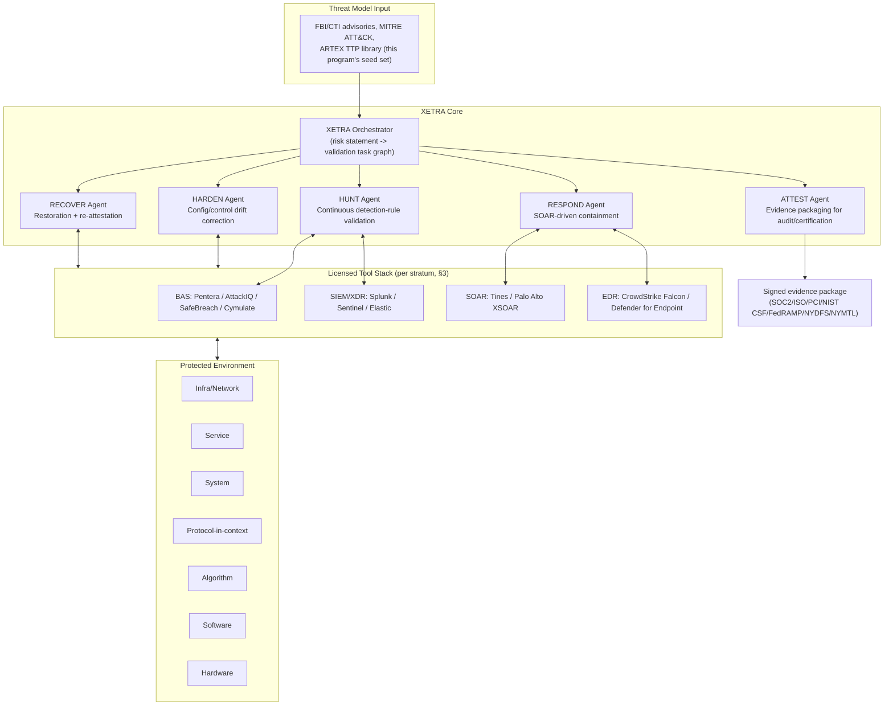
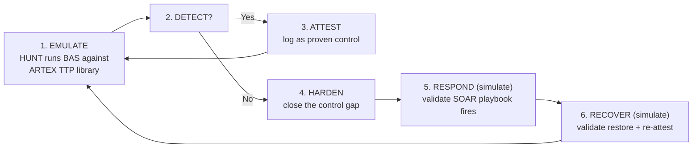

# XETRA

## eXtended Threat Evasion-Resilience & Takedown Architecture

### The structural inverse of ARTEX — same strata, same TTPs, opposite direction.

> **ARTEX, reversed, is XETRA.** Not a metaphor — read the letters backwards. Where ARTEX is an autonomous, LLM-driven agent swarm that turns a one-line goal into a breach, XETRA is an autonomous, licensed-tool-driven agent swarm that turns a one-line threat model into continuous proof that the breach doesn't land, and if it ever does, that it doesn't last.

---

## 0. Design Principle

Every ARTEX capability (per FBI FLASH-20261113-001) has exactly one structural countermeasure in XETRA. Nothing in this package is invented threat theater — each row below traces to a specific, cited ARTEX behavior.

| ARTEX does this | XETRA does the inverse |
| --- | --- |
| Orchestrator turns NL goal → attack task graph | Orchestrator turns NL risk statement → **validation** task graph |
| Specialized SI agents (recon/exploit/privesc/exfil/C2) | Specialized **CI agents** (Counter-Intelligence): Hunt, Harden, Respond, Recover, Attest |
| Calls external LLMs for "what to try next" | Calls licensed BAS/SIEM/SOAR engines for "what to verify next" |
| Succeeds by finding the one gap | Succeeds by closing every gap, continuously, forever |
| Leaves forensic noise as a side effect | Leaves an audit trail as the *product* |
| No bundled model — depends on 3rd-party LLM APIs | No single point of failure — multi-vendor BAS/SIEM/SOAR stack, swappable |

---

## 1. Architecture

**The five agents:**

| Agent | Role | Inverse of |
| --- | --- | --- |
| **HUNT** | Runs licensed BAS attack-emulation continuously against every stratum, using the exact ARTEX-observed TTP library; confirms each one is detected | ARTEX's recon + exploit agents |
| **HARDEN** | Diffs live config against CIS/vendor baselines per stratum; auto-remediates drift (with approval gate for prod) | ARTEX's persistence/privesc agents |
| **RESPOND** | SOAR playbooks triggered by HUNT/SIEM findings — isolate, revoke, rotate, block | ARTEX's lateral-movement/C2 agents |
| **RECOVER** | Rebuilds from known-good (signed images, re-flash firmware, re-hash credential stores), then re-runs HUNT to confirm clean | ARTEX's collection/exfil agents |
| **ATTEST** | Packages every HUNT/HARDEN/RESPOND/RECOVER cycle into certification-ready evidence | ARTEX leaving forensic debris as a byproduct |

---

## 2. The XETRA Loop

This loop runs on a schedule (weekly minimum per stratum, see §4) — it never stops, which is the point: ARTEX runs once against a target and leaves; XETRA runs forever and never does.

---

## 3. Coverage by Stratum (attack-surface order, corrected)

### 3.1 Infrastructure / Network

- **HUNT:** BAS emulation of cloud-perimeter dry-run probing, exposed-admin-plane discovery, cross-tenant trust walk (mirrors ARTEX §1 Recon + §2 Initial Access)
- **HARDEN:** Prowler/ScoutSuite continuous CIS drift correction; auto-flag any new public IP without architecture-review sign-off
- **RESPOND:** SOAR playbook — auto-isolate network segment on anomalous IAM dry-run burst
- **RECOVER:** Re-provision from IaC known-good state; re-validate egress rules

### 3.2 Service

- **HUNT:** DAST/API fuzzing replaying ARTEX's observed SQLi/SSRF/SSTI/auth-bypass chain against staging mirrors
- **HARDEN:** SAST/SCA gate in CI blocks merge on new injection-class finding
- **RESPOND:** Auto-revoke API key / roll back deployment on live-exploit signature match
- **RECOVER:** Redeploy signed build from last-known-good artifact registry

### 3.3 System

- **HUNT:** BAS emulation of Kerberoasting/DCSync/Pass-the-Hash/Pass-the-Ticket against a lab AD tier, confirming SIEM alerting fires
- **HARDEN:** PingCastle/BloodHound Enterprise continuous AD attack-path closure; EDR-coverage-gap auto-ticketing
- **RESPOND:** Forced krbtgt double-reset playbook, auto-triggered on DCSync-pattern alert
- **RECOVER:** Rebuild affected hosts from golden image; LAPS rotation across domain

### 3.4 Protocol-in-context

- **HUNT:** Validate SAML/OAuth forged-assertion rejection; SMB-relay attempt detection
- **HARDEN:** Enforce SMB signing, disable legacy NTLM/LLMNR fleet-wide
- **RESPOND:** IdP signing-key rotation + tenant-wide session invalidation playbook
- **RECOVER:** Reissue short-lived tokens only; confirm old tokens rejected

### 3.5 Algorithm

- **HUNT:** Crypto-agility scan confirms no deprecated hash/cipher/RNG in active use
- **HARDEN:** Policy-enforced migration to NIST SP 800-131A-approved primitives
- **RESPOND:** Emergency key rotation + credential-store re-hash on weak-crypto finding
- **RECOVER:** Replay transaction logs post-rotation to confirm no stale-key usage remains

### 3.6 Software / Language

- **HUNT:** Fuzzing + SCA replaying known deserialization/injection classes against build artifacts
- **HARDEN:** SLSA provenance + Sigstore signing enforced at every build stage
- **RESPOND:** Revoke signing keys, halt pipeline on provenance-chain break
- **RECOVER:** Rebuild from last attested-clean commit; re-sign

### 3.7 Hardware

- **HUNT:** Firmware-hash attestation vs. vendor baseline (Eclypsium / Defender Firmware Protection)
- **HARDEN:** Procurement-gate requiring signed-firmware + hardware SBOM
- **RESPOND:** Physical isolation on attestation-quote failure
- **RECOVER:** Re-flash from verified source or hardware replacement — the one stratum XETRA treats as non-software-remediable, exactly because ARTEX's deepest persistence (and any firmware implant generally) survives an OS wipe

---

## 4. Operating Cadence & Metrics

| Stratum | HUNT frequency | Primary KPI |
| --- | --- | --- |
| Infra/Network | Continuous (BAS agent-based) | Mean time-to-detect perimeter probe |
| Service | Every build (CI-gated) + weekly full DAST | % builds blocked pre-merge on injection class |
| System | Weekly AD attack-path scan | EDR coverage % (target: 100%) |
| Protocol | Weekly | Forged-assertion rejection rate (target: 100%) |
| Algorithm | Monthly crypto-agility audit | Deprecated-primitive count (target: 0) |
| Software | Every build | SLSA provenance pass rate |
| Hardware | Quarterly attestation | Firmware-hash match rate (target: 100%) |

**Program-level KPI, the one that matters most:** replay the full ARTEX-observed kill chain (§1–§8 of the FBI advisory) end-to-end quarterly, as a single BAS campaign. Success = every phase caught before privilege escalation completes. This is XETRA's signature exercise — the direct, literal antidote test.

---

## 5. Evidence Output

Every HUNT/HARDEN/RESPOND/RECOVER cycle auto-generates the ATTEST package already specified in the companion **Security Assurance Scanning Manual** (7 strata × SOC2/ISO27001/PCI DSS/NIST CSF/FedRAMP/NYDFS/NYMTL). XETRA doesn't replace that manual — it's the automation layer that *runs* it continuously instead of as a point-in-time audit exercise.

---

## 6. What XETRA Is Not

- Not an attack tool, not a fork or wrapper of ARTEX, not something that ever touches ARTEX's code or agents.
- Not a single product — it's an architecture + operating model built entirely on named, licensed, vendor-supported tools (Pentera/AttackIQ/SafeBreach/Cymulate, Splunk/Sentinel/Elastic, Tines/XSOAR, CrowdStrike/Defender).
- Not a one-time deployment — the loop in §2 is the product; a XETRA program that stops running stops being XETRA.

---

*XETRA: the only thing ARTEX can't out-automate is a defender that never stops checking.*