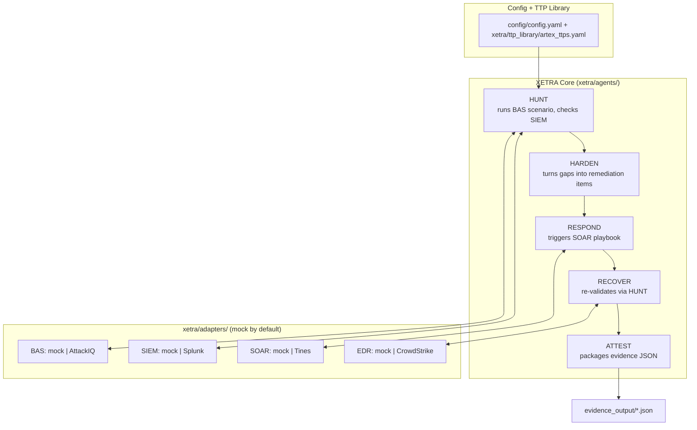

# XETRA Architecture

ARTEX, reversed, is XETRA. Where ARTEX (FBI FLASH-20261113-001) is an autonomous offensive agent swarm that turns a one-line goal into a breach, XETRA is an autonomous validation agent swarm that turns a one-line risk statement into continuous, evidenced proof that the breach doesn't land — and if it ever does, doesn't last.



## The Loop

1. **HUNT** — for every ATT&CK ID in the TTP library, ask the BAS adapter to run its own licensed scenario, then ask the SIEM adapter if it alerted. No exploitation logic lives in this repo; BAS platforms own that.
2. **HARDEN** — every gap becomes a `RemediationItem` with a human-approval flag. XETRA never silently changes production config.
3. **RESPOND** — gaps trigger a named SOAR playbook (isolate/revoke/rotate/block), via your SOAR platform's own approval gates.
4. **RECOVER** — re-runs HUNT against just the remediated technique to confirm the gap is actually closed.
5. **ATTEST** — packages the whole cycle as JSON evidence, cross-walked in `docs/CONTROL_MAPPING.md`.

## Why mock-by-default

Every adapter ships two implementations: a `mock.py` (deterministic, zero credentials, zero risk — this is what runs out of the box) and a vendor-specific "live" stub shaped to that vendor's real, documented public API (`attackiq.py`, `splunk.py`, `tines.py`, `crowdstrike.py`). Flipping a stratum to live mode requires your own license, your own API credentials, and — critically — your own signed scope/Rules-of-Engagement entry in `config.yaml`, because BAS platforms are built to run their safe emulation modules only inside an authorized boundary you define.

## v0.2 additions: memory, engine, API

```
dashboard (browser) ──JSON──> server.py ──> engine.py (one run at a time · stop · pause · schedule)
                                   │             └─> orchestrator.py ─> agents ─> adapters
                                   └─> store.py  (.xetra/: posture · fix list · runs · audit log)
                                       settings.py (config.yaml + secrets.env, write-only)
                                       connect.py  (per-vendor "does this work?" checks)
```

* **Posture is keyed per technique**, not per run. A run only updates what it tested, so a one-stratum run can never hide the other six.
* **A run persists nothing until it finishes.** Stop (or a crash) leaves posture exactly as before.
* **Findings have three statuses** — caught, gap, not_tested — and only a *gap* creates a fix item or can trigger a playbook.
* **`providers.py` is the single source of truth** for what each integration is and needs; Setup, `doctor`, `init` and the docs all derive from it.
