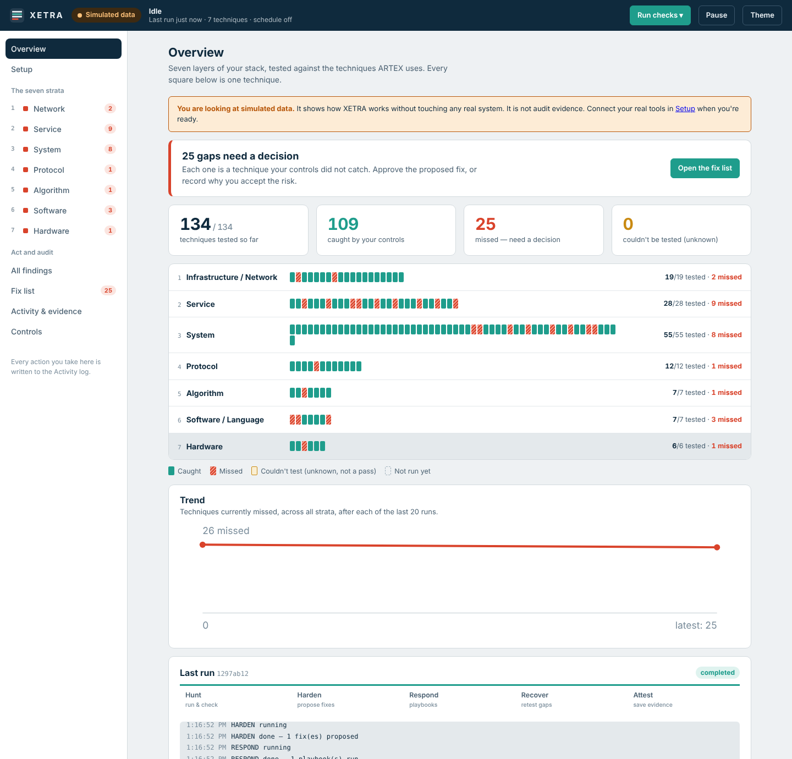
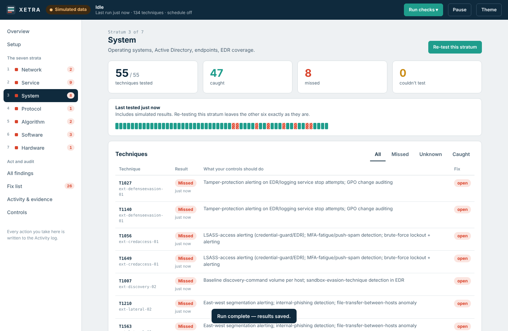
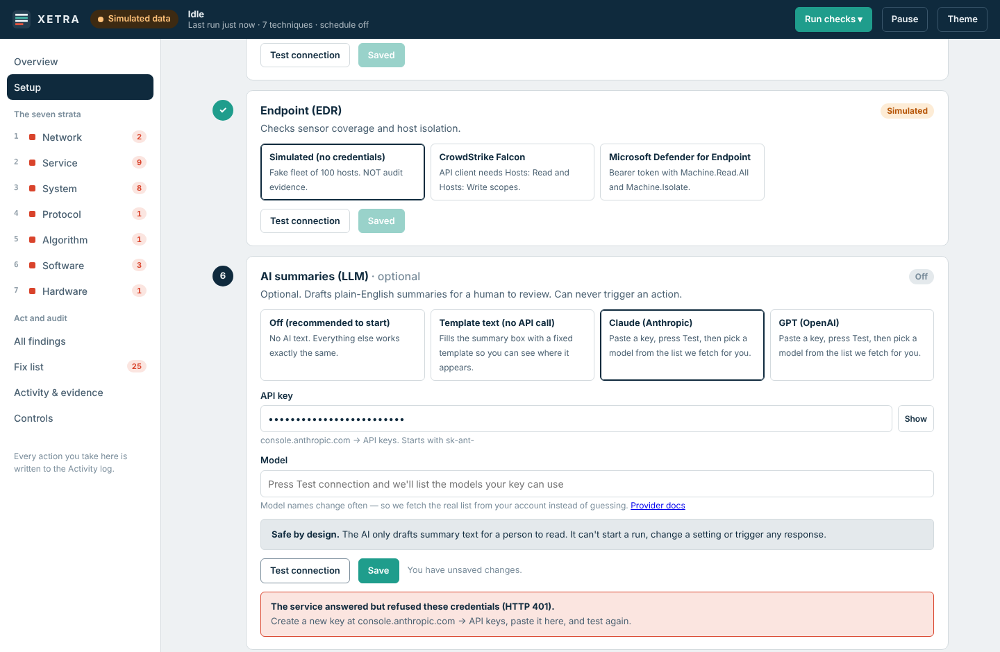
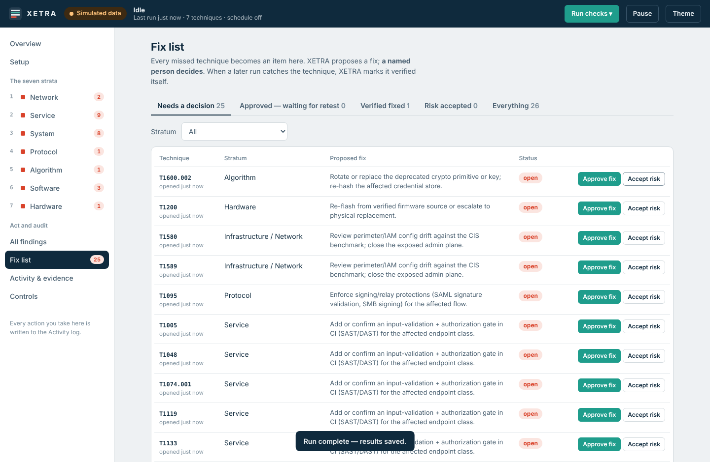
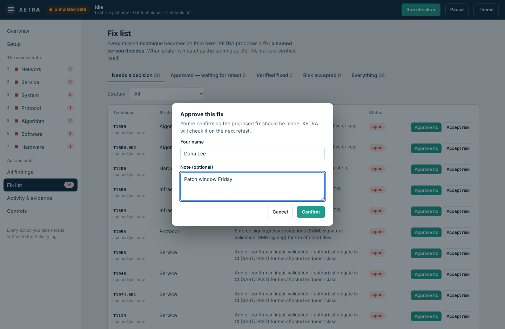
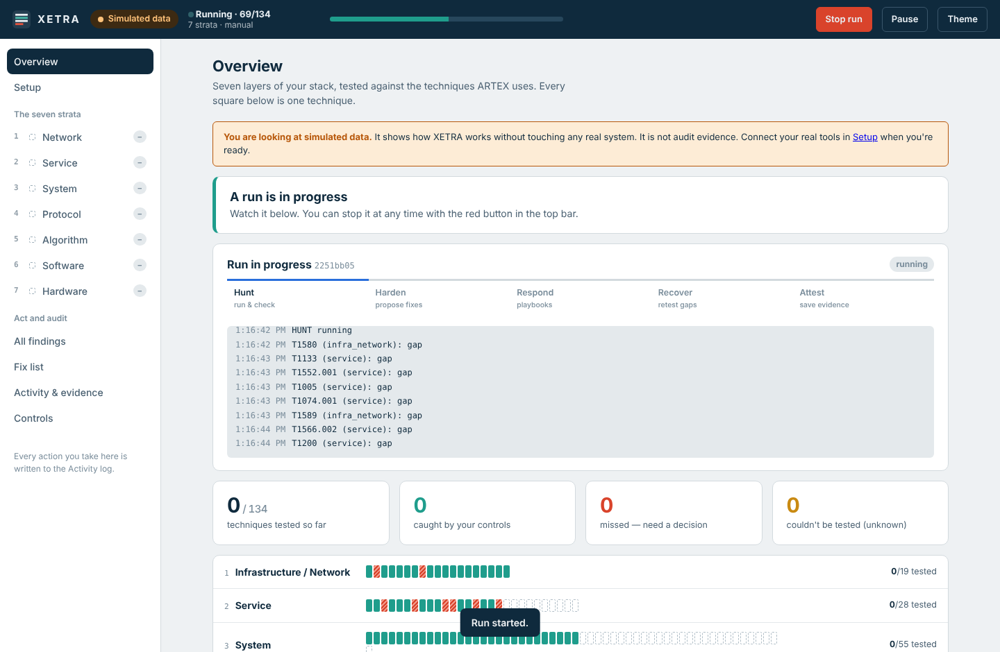
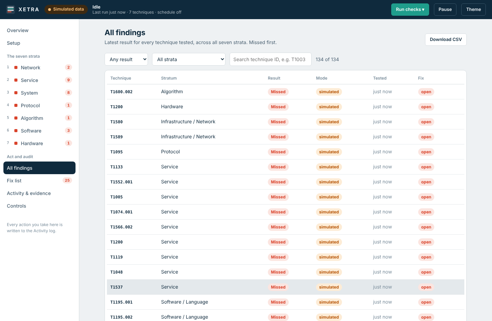
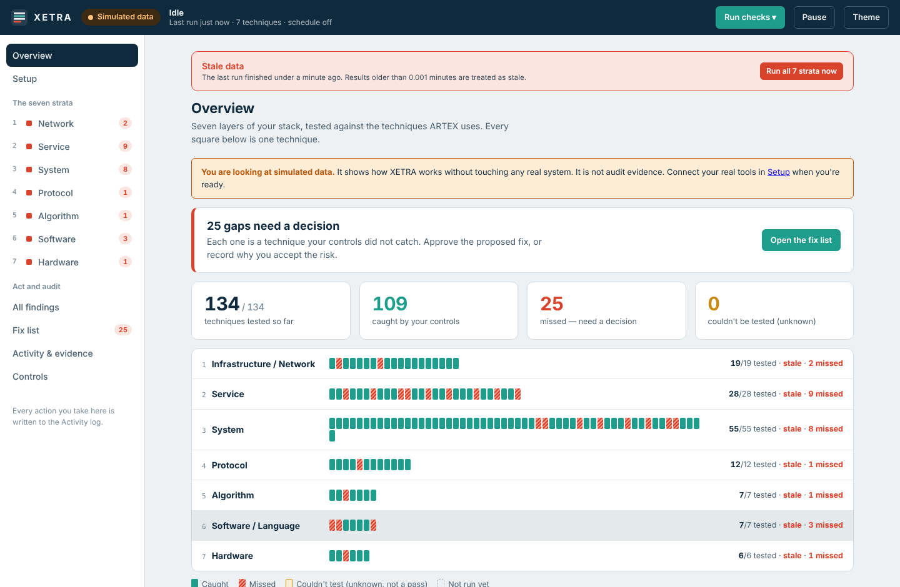
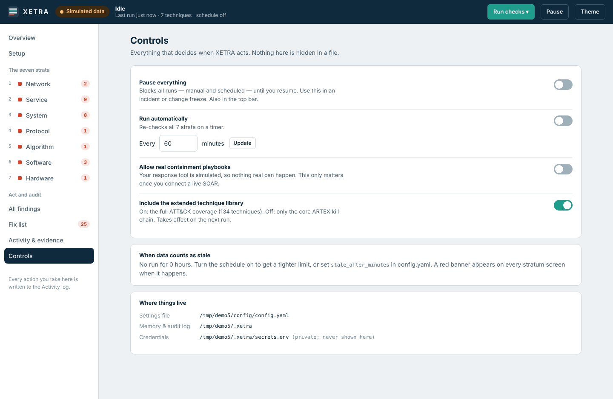
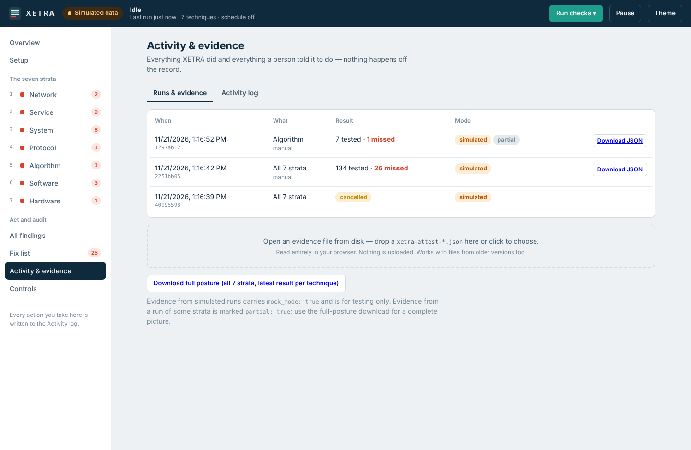

# XETRA

**ARTEX, reversed, is XETRA.** A control-validation dashboard that keeps testing whether your defences catch the techniques described in FBI FLASH-20261113-001 — across all seven layers of your stack — and keeps the proof.



## Start in 60 seconds

**Docker (the demo stack):**

```bash
./up        # → http://localhost:8420   (a cycle starts immediately, then every 5 minutes)
./down      # stop; your data is kept
./clean     # stop and erase everything (asks first; ./clean -y to skip the question)
```

**Without Docker:**

```bash
pip install -e .
xetra start         # creates its own config, opens http://localhost:8420
```

Everything runs on **simulated data** until you connect real tools, so there is nothing to break. The screen tells you what to do next. No account, no credentials, no config file to edit.

> Docker note: the compose file, Dockerfile and scripts are validated by tests, and a container start was replayed outside Docker (same command, paths and environment). `docker compose up` itself has not been run by the authors — if `./up` misbehaves, `docker compose -f docker/docker-compose.yml logs` will say why.

---

## The one idea: you can always see, and always control

| You can always **see** | You can always **do** |
|---|---|
| **Stale data** — a red banner on every stratum screen if results are older than they should be, or the scheduler looks stuck. |
| **Mode** — a badge in the top bar: *Simulated data* or *Live tools*. Simulated results can never be mistaken for evidence. | **Run** any combination of strata from the top bar. Only those are re-tested. |
| **Run state** — idle, running (with a live counter), stopping, paused — on every screen. | **Stop** a run mid-flight. A stopped run saves *nothing*, so half a run never looks like a result. |
| **Every technique** — one square each, on the Overview and on each stratum's tab. | **Pause** everything (manual *and* scheduled runs) with one switch. |
| **Unknown ≠ pass** — a technique XETRA couldn't test is shown as *unknown*, never as caught. | **Decide** each gap: approve the fix, or accept the risk with your name and a reason. |
| **Every action** — runs, decisions, setting changes, connection tests — in the Activity log. | **Schedule**, and turn real containment playbooks on or off. They are **off** by default. |

### Seven strata, seven tabs — and nothing gets lost

Each stratum has its own tab in the left rail with a live health marker and gap count. Re-testing one stratum **only updates that stratum**; the other six keep their last results. (Earlier versions showed only the most recent run, so running one stratum made the other six vanish. That bug is fixed and covered by a regression test.)



---

## Connect your tools — guided, no guessing

**Setup** walks through six steps. For each tool you: pick it, paste the credential, press **Test connection**, then **Save**. You get a plain answer and what to do next:



- **AI summaries (Claude or GPT)** — paste your key and press *Test*. XETRA asks your account which models it can use and gives you a **dropdown**, so you never have to guess a model name. The AI only drafts text for a human to read; it cannot start a run or trigger any response.
- Credentials are **write-only**: stored in `.xetra/secrets.env` (private file), never shown again, never sent to the browser, never written to the log.
- Where a vendor has no safe read-only check, the test says so honestly ("reachable — credentials are proven on the first run") instead of pretending.

| Category | Choices |
|---|---|
| Attack emulation (BAS) | AttackIQ · Pentera · SafeBreach · Cymulate |
| Detection (SIEM) | Splunk · Microsoft Sentinel · Elastic |
| Response (SOAR) | Tines · Cortex XSOAR |
| Endpoint (EDR) | CrowdStrike Falcon · Microsoft Defender for Endpoint |
| AI summaries (optional) | Claude (Anthropic) · GPT (OpenAI) |

Switch **one category at a time**; mix simulated and live freely. Details per vendor: [docs/GOING_LIVE.md](GOING_LIVE.md).

## The fix list — humans decide

Every missed technique becomes an item. XETRA proposes the fix; **a named person decides**. When a later run catches the technique, XETRA marks it **verified** itself — and re-opens it if it regresses.





## Watch a run, stop it any time



The five agents run in order — **Hunt** (run the emulation, check for an alert) → **Harden** (propose fixes) → **Respond** (containment playbook) → **Recover** (retest each gap) → **Attest** (save the evidence package).

## All findings, trend, and evidence files



* **All findings** — every technique's latest result in one filterable table.
* **Trend** (Overview) — techniques currently missed across *all* strata after each of the last 20 runs, so a one-stratum re-test never distorts the line.
* **Open an evidence file** — drop any `xetra-attest-*.json` (including from v0.1) onto Activity & evidence to read it. Entirely in your browser.



## Controls and audit





* **Evidence** per run (`evidence_output/*.json`), labelled `mock_mode`, `partial` and which strata it covered. **Download full posture** gives one complete, current snapshot of all seven strata.
* **Activity log** (`.xetra/events.jsonl`) is append-only and downloadable.

---

## What the status words mean

| Word | Meaning |
|---|---|
| **Caught** | The simulation was blocked or alerted on. |
| **Missed** | It ran and nothing caught it. A real finding → goes on the fix list. |
| **Couldn't test (unknown)** | XETRA couldn't run it (missing mapping, vendor error). **Not a pass, not a gap.** Never triggers containment. |
| **Not run yet** | No result exists. Not "passing". |

## Safety defaults

* Listens on **127.0.0.1** only. Requests from other sites or hostnames are refused.
* **Real containment playbooks are off** until a human enables them. While off, XETRA records what it *would* have run.
* An LLM failure (bad key, outage) never costs you a run's evidence.
* A live attack-emulation tool requires a recorded authoriser (`doctor` fails without one).

## Commands

| Command | What it does |
|---|---|
| `xetra start` | Create config if needed and open the dashboard. **Most people only need this.** |
| `xetra run [--strata service,system]` | Run from the terminal. |
| `xetra status` | All 7 strata on one screen. |
| `xetra doctor` | Pre-flight checks, each with its fix. |
| `xetra init` | Terminal setup wizard (the Setup tab does the same). |
| `xetra list-ttps` | Every technique XETRA validates (134 across all 7 strata). |

In Docker, set `XETRA_SCHEDULE_MINUTES` (default 5) to change the automatic cycle; changing the schedule in the dashboard always wins.

## Honest limits

* **XETRA validates; it does not prevent.** It tells you whether your controls *catch* the techniques and keeps the proof. It does not stop an attacker by itself, so it is not a literal "antidote" — it is how you find out, continuously, whether you have one.
* **Simulated mode is a demo, not evidence.** Results are generated, and every package says `mock_mode: true`.
* **Vendor adapters are written to each vendor's public API documentation but have not been exercised against live tenants** (only the Anthropic and OpenAI model-list checks, Splunk, Elastic, CrowdStrike and Defender "whoami" checks are implemented as real calls, and those too need your credentials to confirm). Test each in Setup and run one stratum before trusting a full cycle.
* The ARTEX technique list is taken from the advisory text supplied with this project; check it against the original FLASH.
* No exploitation logic exists in this repository. Live adapters only ask a licensed vendor's platform to run *its own* scenario.

## Layout

```
xetra/
├── xetra/core/        store (memory), engine (run/stop/pause/schedule), connect (tests), settings, views
├── xetra/agents/      hunt · harden · respond · recover · attest
├── xetra/adapters/    bas · siem · soar · edr · llm   (each: mock + live vendors)
├── xetra/providers.py one table that drives Setup, doctor, wizard and docs
├── xetra/server.py    dashboard + JSON API (stdlib only)
├── dashboard/         the single-file UI (no CDN, works offline)
├── detections/        Sigma rules      ├── docs/    guides, control mapping
└── tests/             64 tests: nothing is lost, stop works, secrets stay secret, Docker files are consistent
```

MIT licensed. See `docs/` for the architecture, control mapping (SOC 2 · ISO 27001 · PCI DSS 4.0 · NIST CSF 2.0 · FedRAMP · NYDFS 500 · NY MTL) and LLM boundary.
